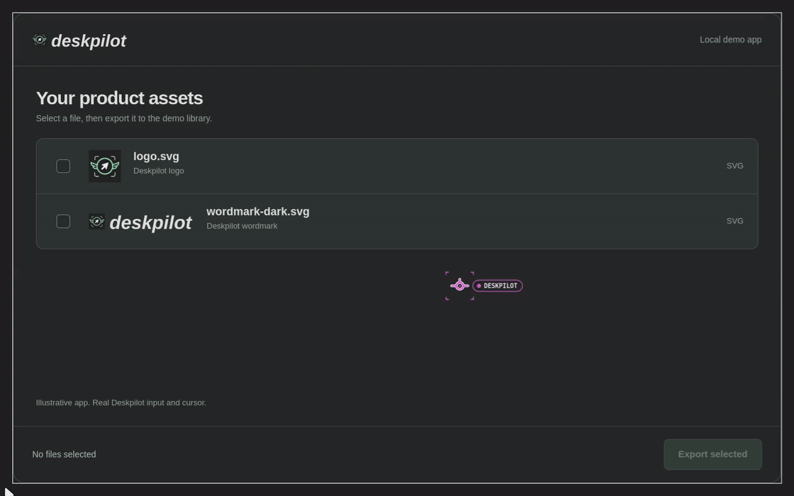

<div align="center">

<picture>
  <source media="(prefers-color-scheme: dark)" srcset="assets/wordmark-dark.svg">
  
</picture>

**Give your agent a desktop.**

Screenshots, accessibility trees, clicks and keys in one app window, for coding agents and MCP clients on Linux
(Hyprland), Windows and macOS, while your own pointer and keyboard stay with you.

[](https://github.com/agent-labs-dev/deskpilot/actions/workflows/ci.yml)
[](https://pypi.org/project/deskpilot/)


</div>

---

## Why deskpilot

- **You keep working.** Input goes to the target app, not through your pointer and keyboard. Only
  `--take-pointer`, `--take-focus` and `--show` move them, and only when you pass them.
- **It never guesses a target.** A window name that matches two windows is an error listing both. A point is read
  against a recorded screenshot of one window at one size, and a point under another window is refused.
- **Elements, found live.** `elements` prints the app's accessibility tree with ids. An action finds the element
  again where the app reports it then, and refuses it if it changed, rather than clicking where it used to be.
- **Errors a program can branch on.** Every expected failure carries one code: `not_found`, `ambiguous`,
  `covered`, `stale`, `unavailable` and so on.
- **CLI, MCP and a skill.** The same actions as commands, as MCP tools over stdio, and as a Claude Code skill.
  Browser tasks go to [fastbrowse](https://github.com/agent-labs-dev/fastbrowse), which calls deskpilot for
  native apps.



A local demo app on Hyprland, operated by deskpilot with its agent cursor and click feedback.
[Static image](assets/walkthrough/walkthrough.png) | [60 fps video](assets/walkthrough/walkthrough.mp4) |
[Recording and source](assets/walkthrough/CAPTURE.md)

## Platforms

| | Linux (Hyprland) | Windows 10 and 11 | macOS 13 and later |
|---|---|---|---|
| Windows, screenshots | grim | PrintWindow | screencapture |
| Accessibility tree | AT-SPI | UI Automation | AX |
| Click, scroll, drag, hover | in the compositor, to the app's own pointer | window messages posted to the window | events posted to the app's process |
| Element click | at the element's centre | UI Automation Invoke, else its centre | AX Press, else its centre |
| Keys and text | on your keymap, in the compositor | posted to the focused control, with its buttons and modifiers in the app's key state | posted to the app's process |
| Hidden agent windows, adoption, private paste, `record`, recipes, `--session` | yes | no (`unavailable`) | no (`unavailable`) |

On Hyprland every action is exact. On Windows and macOS, input posted to an app that is not in front reaches most
standard controls. Some apps read the real keyboard or pointer and ignore it, such as games, many Electron and
Chromium apps, and drag and drop. For those, pass `--take-focus`, which brings the window in front first, or
`--take-pointer`, which uses your own pointer.
macOS needs Accessibility and Screen Recording access for the app that runs deskpilot (your terminal, or the
agent's app), granted in System Settings > Privacy & Security.

## Install

```sh
uv tool install deskpilot
```

On Hyprland, the first input action builds and loads the plugin for your running compositor. Run
`deskpilot plugin load` to prepare it ahead of time. The build needs the tools listed under
[Requirements](#requirements). Windows and macOS need nothing beyond the package.

For Claude Code, install the agent skill:

```text
/plugin install deskpilot --marketplace agent-labs-dev/deskpilot
```

For MCP clients, run `deskpilot mcp` over stdio. In Claude Code:

```sh
claude mcp add deskpilot -- deskpilot mcp
```

## Quickstart

List your windows, then replace `WINDOW` below with one address from the output:

```sh
deskpilot windows
deskpilot elements WINDOW
```

In an app with an accessibility tree, choose a control from the output and replace `ELEMENT` with its ID:

```sh
deskpilot click WINDOW --element ELEMENT
```

Deskpilot asks the app for that element's current position before clicking. Prefer the full `SNAPSHOT:e27` form
from the reported snapshot and element ID, so a newer tree cannot reuse an old ID accidentally.

For an app without a tree, capture its window:

```sh
deskpilot shot WINDOW
```

Read the image at the printed path, then click a point in that image with
`deskpilot click WINDOW X Y --shot SHOT_ID`, replacing `X`, `Y` and `SHOT_ID` with the point and printed shot ID.
A resized window or a point outside the recorded window is refused. Take a fresh shot to verify the result;
use `wait-for WINDOW --changed SHOT_ID` when the app needs time to draw it.

[More actions and targeting rules](docs/reference.md) | [Accessibility and popup handling](docs/reference.md#use)

## Chain known actions

Send a JSON array through a file or stdin to run up to 32 steps in one CLI process or MCP request:

```sh
deskpilot batch WINDOW --final-shot <<'JSON'
[
  {"action": "key", "combo": "ctrl+a"},
  {"action": "type", "text": "Hello from deskpilot"}
]
JSON
```

This example replaces text in the target app's current field. Run it only after inspecting that field.
To film a window with the agent cursor (brackets closing in on a landing, the marker squeezing on a press), run
`deskpilot record WINDOW -o clip.mp4 --seconds 10`, or `-o -` for PPM frames at a constant rate on stdout. It works for
hidden windows too (`--hidden`), and the cursor shows in the clip alone. Screenshots from `shot` never include it.

Supported steps are `click`, `move`, `scroll`, `drag`, `key`, `type` and `paste`. Element IDs and shot IDs work
on the corresponding pointer steps. `--final-shot` returns a capture after all steps succeed.

The entire request is validated before input starts. Each step rechecks the pinned window and uses the same
refusals as a single action. A failure stops the batch and reports the completed steps and failing index;
earlier actions stay done. Other agents and the user can act between steps.

[Batch format and results](docs/reference.md#batch)

## Record a demo from a recipe (Hyprland)

A recipe is a saved sequence of steps for one window, with the beats a viewer needs, recorded in one run:

```sh
deskpilot recipe check recipes/export-an-asset.json
deskpilot recipe run recipes/export-an-asset.json --record demo.mp4
```

The steps are the batch actions plus `pause`, `wait` and `shot`; a recipe may also start its own app and name the
MP4 it records. The recording is `deskpilot record` of the window, so the video holds the agent cursor deskpilot
draws. `deskpilot recipe schema` prints the format as JSON Schema. Nothing is launched or clicked until the whole
file validates, and a failed step stops the run, keeps the recording and exits 2.

[Recipe format and recording](docs/recipes.md)

## Work on your own hidden window (Hyprland)

Set an agent name and launch a native Wayland app of your own:

```sh
export DESKPILOT_AGENT=demo
deskpilot launch APP
```

Replace `APP` with an installed app and use the window it reports. Add `--hidden` to actions on those windows,
including `batch`; hidden keys and text also need `--window`. `deskpilot stop` closes your agent's apps.
`deskpilot show` intentionally brings the agent workspace into view for you to watch or step in.

For an existing unfocused native window, `deskpilot adopt ADDRESS` explicitly hands only that exact window to
the agent. `deskpilot release ADDRESS` returns it without closing its shared application.

Hidden actions preserve your view, pointer and focus and only reach windows that agent launched or adopted. XWayland targets
are refused hidden. For browser tasks, use [fastbrowse](https://github.com/agent-labs-dev/fastbrowse).

For a private desktop with separate profiles, clipboard and X server, put `--session` before every command,
starting with `DESKPILOT_AGENT=NAME deskpilot --session launch APP`. End it with `deskpilot --session stop`.

[Hidden-window behaviour, adoption and private desktops](docs/input-routing.md)

`eval "$(deskpilot --session env)"` starts that desktop if needed and exports what reaches it (`WAYLAND_DISPLAY`,
`HYPRLAND_INSTANCE_SIGNATURE`, `XDG_RUNTIME_DIR`, `DBUS_SESSION_BUS_ADDRESS` and `AT_SPI_BUS_ADDRESS`), so other tools
such as `grim` or `wf-recorder` can use it; `--json` prints it as JSON. Your shell keeps its own profile, and `stop`
leaves what you started this way running.

### With no desktop: a container

`container/Dockerfile` builds an image whose `--session` desktop needs no GPU and no compositor around it: with
`DESKPILOT_STANDALONE=1` and `DESKPILOT_AGENT=agent` (set in the image) Hyprland runs on its own DRM backend on the
kernel's virtual display, vkms, rendered in software by Mesa. On the host, load vkms and pass its display node in:

```sh
sudo modprobe vkms
docker build -f container/Dockerfile -t deskpilot .
docker run --rm --device /dev/dri deskpilot bash -c 'eval "$(deskpilot --session env)"; deskpilot --session launch APP'
```

The entrypoint gives the image's `agent` user the display node's group and runs the command as that user, since
Hyprland refuses to run as root. The image's plugin is prebuilt against its pinned Hyprland. `container/smoke.sh` is
the check CI runs in it: it launches a GTK app, clicks its entry, types and reads the text back, recording a clip.
GitHub's `ubuntu-24.04` runners can load vkms; a runner without the module cannot run it.

## Your input stays yours

The plugin sends input to the target client directly where supported. Some clients, including XWayland,
require a seat-based route that briefly holds input, restores your pointer and focus, and replays intervening
user input. A private paste preserves your clipboard; apps that cannot receive one are refused.

`--take-pointer`, `--take-focus` and `--show` explicitly take your pointer, focus or view.
[Input routes and their limits](docs/input-routing.md) explains the client-specific behaviour.

## Requirements

Python 3.12 or later and `uv` everywhere. On Windows and macOS that is all; macOS also needs the permissions under
[Platforms](#platforms). On Linux:

- Hyprland, with `hyprctl` on `PATH`. Version 0.57's Lua dispatchers and the older string ones both work.
- The plugin build tools: a C++26 compiler, `make`, Hyprland's headers (`pkg-config hyprland`, shipped with
  Arch's `hyprland` package), `libxcb`, `libxkbcommon` and `cairo`.
- `grim` for screenshots.
- `wl-clipboard` for `clipboard`.
- For `--take-pointer`: write access to `/dev/uinput`, usually through the `input` group or a udev ACL. Check with
  `test -w /dev/uinput`.

## Documentation and contributing

- [Command guide](docs/reference.md): actions, screenshots, accessibility, MCP and error codes.
- [Recipes](docs/recipes.md): a demo as data, replayed in order and recorded to an MP4.
- [Input routing](docs/input-routing.md): dedicated seats, keymaps, agent cursors and hidden windows.
- [Live calibration](docs/calibration.md): isolated input checks and cleanup verification.
- [Contributing](CONTRIBUTING.md): setup, checks and bug reports.
- [Security](SECURITY.md): report a vulnerability privately.
- [Changelog](CHANGELOG.md): changes by release.
