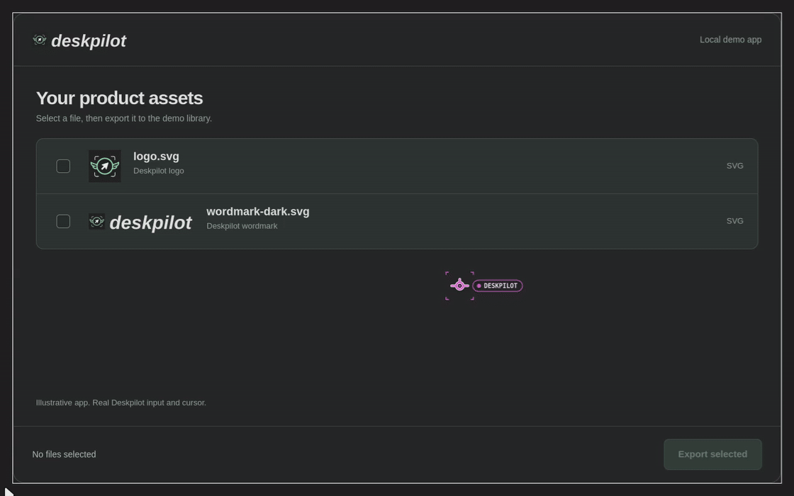

<p align="center">
  <picture>
    <source media="(prefers-color-scheme: dark)" srcset="assets/wordmark-dark.svg">
    
  </picture>
</p>

# deskpilot

Desktop control for agents on Hyprland. Inspect a window, target an accessibility element or a screenshot point,
and click, scroll or type while you keep working.

[](https://github.com/cjber/deskpilot/actions/workflows/ci.yml)
[](https://pypi.org/project/deskpilot/)




A local demo app, operated by Deskpilot with its real cursor and click feedback.
[Static image](assets/walkthrough/walkthrough.png) | [60 fps video](assets/walkthrough/walkthrough.mp4) |
[Recording and source](assets/walkthrough/CAPTURE.md)

| What you need | What deskpilot gives you |
|---|---|
| Find a control | Live accessibility trees with element IDs, or a window screenshot with recorded coordinates |
| Send input | Click, scroll, hover, drag, type, key chords and private paste |
| Work out of sight | Launch your own native Wayland apps on an agent's hidden workspace |
| Reduce round trips | CLI and MCP actions, plus a sequence of known steps in one batch |

## Install

```sh
uv tool install deskpilot
```

The first input action builds and loads the plugin for your running Hyprland. Run `deskpilot plugin load` to
prepare it ahead of time. The build needs the tools listed under [Requirements](#requirements).

For Claude Code, install the agent skill:

```text
/plugin install deskpilot --marketplace cjber/deskpilot
```

For MCP clients, run `deskpilot mcp` over stdio. In Claude Code:

```sh
claude mcp add deskpilot -- deskpilot mcp
```

## Quickstart

List your windows, then replace `WINDOW` below with one address from the output:

```sh
deskpilot windows
deskpilot elements WINDOW
```

In an app with an accessibility tree, choose a control from the output and replace `ELEMENT` with its ID:

```sh
deskpilot click WINDOW --element ELEMENT
```

Deskpilot asks the app for that element's current position before clicking. Prefer the full `SNAPSHOT:e27` form
from the reported snapshot and element ID, so a newer tree cannot reuse an old ID accidentally.

For an app without a tree, capture its window:

```sh
deskpilot shot WINDOW
```

Read the image at the printed path, then click a point in that image with
`deskpilot click WINDOW X Y --shot SHOT_ID`, replacing `X`, `Y` and `SHOT_ID` with the point and printed shot ID.
A resized window or a point outside the recorded window is refused. Take a fresh shot to verify the result;
use `wait-for WINDOW --changed SHOT_ID` when the app needs time to draw it.

[More actions and targeting rules](docs/reference.md) | [Accessibility and popup handling](docs/reference.md#use)

## Chain known actions

Send a JSON array through a file or stdin to run up to 32 steps in one CLI process or MCP request:

```sh
deskpilot batch WINDOW --final-shot <<'JSON'
[
  {"action": "key", "combo": "ctrl+a"},
  {"action": "type", "text": "Hello from deskpilot"}
]
JSON
```

This example replaces text in the target app's current field. Run it only after inspecting that field.
Supported steps are `click`, `move`, `scroll`, `drag`, `key`, `type` and `paste`. Element IDs and shot IDs work
on the corresponding pointer steps. `--final-shot` returns a capture after all steps succeed.

The entire request is validated before input starts. Each step rechecks the pinned window and uses the same
refusals as a single action. A failure stops the batch and reports the completed steps and failing index;
earlier actions stay done. Other agents and the user can act between steps.

[Batch format and results](docs/reference.md#batch)

## Work on your own hidden window

Set an agent name and launch a native Wayland app of your own:

```sh
export DESKPILOT_AGENT=demo
deskpilot launch APP
```

Replace `APP` with an installed app and use the window it reports. Add `--hidden` to actions on those windows,
including `batch`; hidden keys and text also need `--window`. `deskpilot stop` closes your agent's apps.
`deskpilot show` intentionally brings the agent workspace into view for you to watch or step in.

For an existing unfocused native window, `deskpilot adopt ADDRESS` explicitly hands only that exact window to
the agent. `deskpilot release ADDRESS` returns it without closing its shared application.

Hidden actions preserve your view, pointer and focus and only reach windows that agent launched or adopted. XWayland targets
are refused hidden. For browser tasks, use [fastbrowse](https://github.com/agent-labs-dev/fastbrowse).

For a private desktop with separate profiles, clipboard and X server, put `--session` before every command,
starting with `DESKPILOT_AGENT=NAME deskpilot --session launch APP`. End it with `deskpilot --session stop`.

[Hidden-window behaviour, adoption and private desktops](docs/input-routing.md)

## Your input stays yours

The plugin sends input to the target client directly where supported. Some clients, including XWayland,
require a seat-based route that briefly holds input, restores your pointer and focus, and replays intervening
user input. A private paste preserves your clipboard; apps that cannot receive one are refused.

`--take-pointer`, `--take-focus` and `--show` explicitly take your pointer, focus or view.
[Input routes and their limits](docs/input-routing.md) explains the client-specific behaviour.

## Requirements

- Hyprland, with `hyprctl` on `PATH`. Version 0.57's Lua dispatchers and the older string ones both work.
- The plugin build tools: a C++26 compiler, `make`, Hyprland's headers (`pkg-config hyprland`, shipped with
  Arch's `hyprland` package), `libxcb`, `libxkbcommon` and `cairo`.
- `grim` for screenshots.
- `wl-clipboard` for `clipboard`.
- For `--take-pointer`: write access to `/dev/uinput`, usually through the `input` group or a udev ACL. Check with
  `test -w /dev/uinput`.
- Python 3.12 or later and `uv`.

## Documentation and contributing

- [Command guide](docs/reference.md): actions, screenshots, accessibility, MCP and error codes.
- [Input routing](docs/input-routing.md): dedicated seats, keymaps, agent cursors and hidden windows.
- [Live calibration](docs/calibration.md): isolated input checks and cleanup verification.
- [Contributing](CONTRIBUTING.md): setup, checks and bug reports.
- [Security](SECURITY.md): report a vulnerability privately.
- [Changelog](CHANGELOG.md): changes by release.
